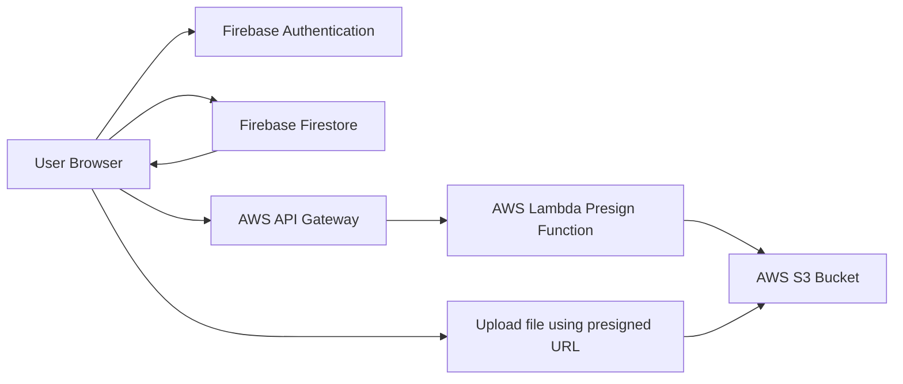

# Cloud Notes App with AWS S3 Integration

live at : https://cloud-notes-app-d4219.web.app/

Cloud Notes is a beginner-friendly cloud notes management web app for an LP-II Cloud Computing mini project. It uses Firebase Authentication for login/signup, Firebase Firestore for real-time note storage, Firebase Hosting for deployment, and AWS S3 for note attachments.

## Features

- User signup and login with Firebase Authentication
- Create, edit, delete, and view personal notes
- Real-time note updates using Firebase Firestore
- Upload optional attachments such as PDFs, images, documents, and spreadsheets
- Store attachment files in AWS S3
- Store note details and attachment references in Firestore
- Responsive HTML, CSS, and JavaScript frontend

## Project Structure

```text
.
├── index.html
├── styles.css
├── app.js
├── firebase-config.js
├── firebase.json
├── firestore.rules
├── functions/
│   ├── aws-s3-presign-lambda.js
│   └── package.json
└── README.md
```

## Architecture



The browser never stores AWS access keys. It requests a temporary presigned upload URL from AWS Lambda, uploads the file directly to S3, and saves only the S3 object key inside the Firestore note document. When a user opens an attachment, Lambda returns a short-lived download URL.

## Firebase Setup

1. Create a Firebase project.
2. Enable Authentication > Sign-in method > Email/Password.
3. Create a Firestore database.
4. Register a Web App in Firebase Project Settings.
5. Copy the Firebase config into `firebase-config.js`.
6. Install Firebase CLI if needed:

```bash
npm install -g firebase-tools
```

7. Login and connect the project:

```bash
firebase login
firebase init hosting firestore
```

When asked for the public directory, use `.`. Keep `index.html` as the single-page app entry file.

8. Deploy Firestore rules:

```bash
firebase deploy --only firestore:rules
```

## AWS S3 Setup

1. Create an S3 bucket, for example `cloud-notes-attachments-yourname`.
2. In the bucket CORS settings, allow browser uploads from your Firebase Hosting URL:

```json
[
  {
    "AllowedHeaders": ["*"],
    "AllowedMethods": ["GET", "PUT"],
    "AllowedOrigins": ["https://YOUR_PROJECT_ID.web.app", "http://localhost:5000"],
    "ExposeHeaders": ["ETag"],
    "MaxAgeSeconds": 3000
  }
]
```

3. Create an IAM role for Lambda with permission to upload objects to this bucket:

```json
{
  "Version": "2012-10-17",
  "Statement": [
    {
      "Effect": "Allow",
      "Action": ["s3:PutObject", "s3:GetObject"],
      "Resource": "arn:aws:s3:::YOUR_BUCKET_NAME/notes/*"
    }
  ]
}
```

4. Create an AWS Lambda function using Node.js 20 or Node.js 18.
5. Upload the code from `functions/aws-s3-presign-lambda.js` with its dependencies.
6. Add these Lambda environment variables:

```text
AWS_REGION=ap-south-1
S3_BUCKET_NAME=YOUR_BUCKET_NAME
ALLOWED_ORIGIN=https://YOUR_PROJECT_ID.web.app
```

7. Create an API Gateway HTTP API route connected to Lambda:

```text
POST /presign
OPTIONS /presign
```

8. Copy the API Gateway URL into `S3_PRESIGN_API_URL` in `firebase-config.js`.

## Running Locally

Use Firebase Hosting locally:

```bash
firebase serve
```

or:

```bash
firebase emulators:start --only hosting
```

Open the local URL shown by Firebase, usually:

```text
http://localhost:5000
```

For a quick static preview without Firebase CLI, you can also run:

```bash
node tools/local-server.mjs
```

Then open:

```text
http://localhost:5500
```

## Deploying

After adding Firebase and AWS configuration:

```bash
firebase deploy
```

## Firestore Data Model

Each user has private notes under:

```text
users/{userId}/notes/{noteId}
```

Example note document:

```json
{
  "title": "Cloud computing assignment",
  "content": "Prepare Firebase and AWS S3 demo.",
  "createdAt": "server timestamp",
  "updatedAt": "server timestamp",
  "attachment": {
    "name": "diagram.pdf",
    "type": "application/pdf",
    "size": 45678,
    "key": "notes/userId/1719000000000-diagram.pdf"
  }
}
```

## Viva Explanation Points

- Firebase Authentication provides Authentication as a Service.
- Firestore is a scalable NoSQL cloud database with real-time listeners.
- Firebase Hosting deploys the frontend globally.
- AWS S3 provides durable object storage for uploaded files.
- AWS Lambda and API Gateway generate temporary upload and download URLs so AWS keys are never exposed in frontend JavaScript.
- Firestore security rules ensure users can access only their own notes.
- The app demonstrates multi-cloud usage by combining Firebase and AWS.

## Notes for Demonstration

- First show signup/login.
- Create a note without an attachment.
- Edit the note and show the real-time update.
- Upload a PDF or image attachment.
- Open the attachment link from the saved note.
- Delete the note.
